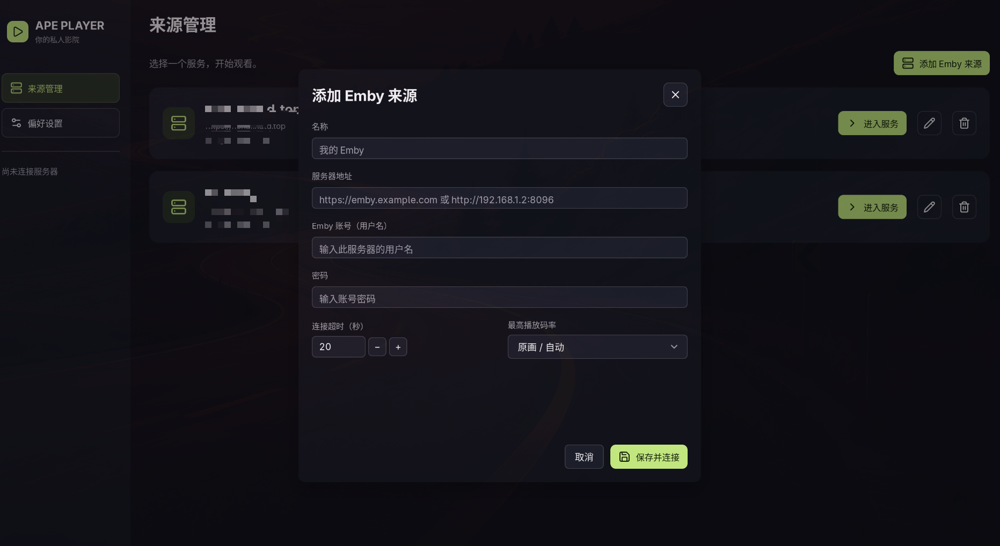
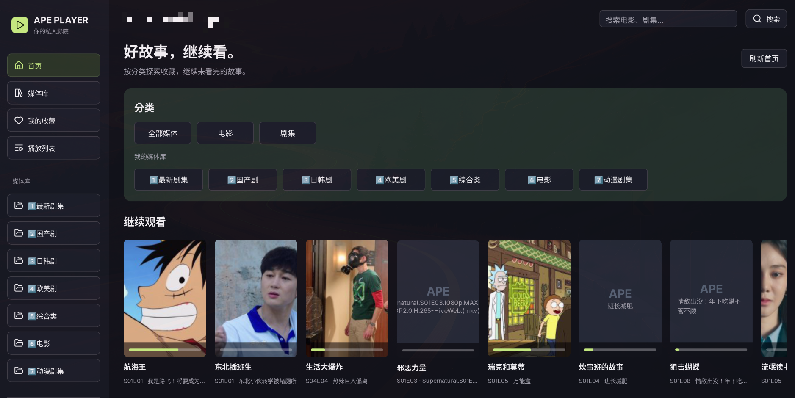
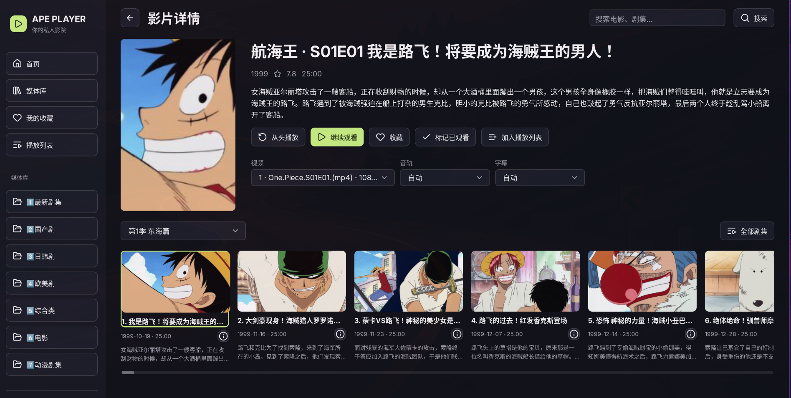
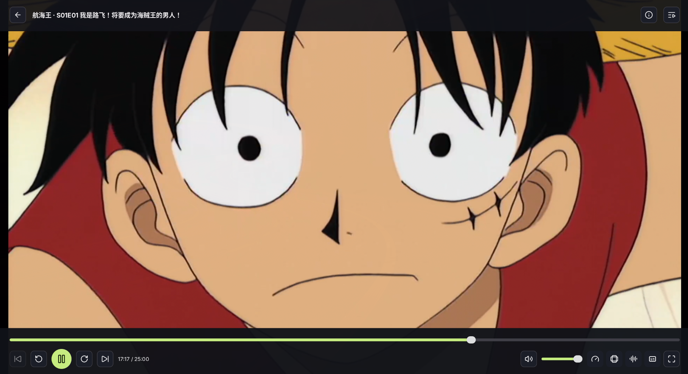

# Ape Player

Linux 桌面 Emby 播放器。界面完全使用 **MyGO Native UI**，视频由 **libmpv + OpenGL** 内嵌渲染，无 WebView、JavaScript 或外部播放窗口。界面采用 [Lucide](https://lucide.dev/) SVG 图标，由 MyGO 原生渲染，随程序离线打包。

## 界面预览

从添加来源、浏览分类到选集播放。点击截图查看原图。

| 来源管理与账号登录 | 首页分类与继续观看 |
| --- | --- |
| [](preview/source.png) | [](preview/list.png) |

| 影片详情与选集 | 原生视频播放 |
| --- | --- |
| [](preview/video.png) | [](preview/player.png) |

## 运行

需要 Go 1.27.1+、GTK 3、libepoxy、OpenGL 驱动和 `libmpv.so.2`。首次构建需要下载 Go 依赖。

```bash
# Arch Linux / Omarchy
sudo pacman -S --needed go gtk3 libepoxy mpv

# Debian / Ubuntu（Go 需另外安装满足版本要求的版本）
sudo apt install libgtk-3-0 libepoxy0 libmpv2

make build
./build/ape-player
```

应用在 GTK 初始化后自动将进程内 `LC_NUMERIC` 设置为 libmpv 要求的 `C`，保留其他语言与 UTF-8 设置；无需修改系统 locale 或启动命令。

支持 Wayland 和 X11。可用 `GDK_BACKEND=wayland` 或 `GDK_BACKEND=x11` 选择后端。需要实际可用的 OpenGL；`MYGO_GPU=0` 只适合检查普通 UI，不能播放视频。

可选安装到用户目录（无需 root）：

```bash
./scripts/install.sh
```

## 使用

1. 启动默认显示「来源管理」，选择服务后进入该服务的首页。添加与编辑来源均使用弹窗，可通过取消、关闭按钮、Esc 或点击遮罩关闭。点击「添加 Emby 来源」填写 Emby 地址，支持端口和反向代理路径，如 `https://example.com/emby`。
2. 在添加来源时填写该服务器的账号（用户名）和密码，点击「保存并登录」；也可以先保存来源，再到登录页输入。可为不同来源保存各自的账号；点击服务卡片或「进入服务」使用保存的登录。左下角「返回来源管理」回到服务列表并保留登录；顶部箭头返回上一页，保留分类、筛选、页码和季度选择。播放器返回播放前的页面。
3. 首页展示「继续观看」以及按服务器顺序排列的媒体库封面横排（每个媒体库最近添加的最多 18 项）。首页和分集横排隐藏滚动条，支持按住卡片或空白处左右拖动，也可使用滚轮或触控板滚动；轻点仍打开详情或播放。通过左侧媒体库导航或各栏「查看所有」进入对应分类；「继续观看」按最后播放时间展示未看完的内容；播放后返回首页会等待进度上报完成并自动刷新，包括经详情或媒体库逐级返回。媒体库支持搜索、分页、类型/观看状态筛选、排序。
4. 进入电影或剧集详情选择版本、收藏、标记观看，或播放。整剧和单集详情均按季展示横向分集卡片，向右滚动可浏览整季，仅渲染当前可见及附近的卡片并按需加载缩略图。单集详情默认选择所属季度；卡片显示缩略图、集名、首播日期、时长及简介，点击直接播放。「全部剧集」打开可滚动的数字选集弹窗，支持切换季度、当前剧集高亮和点击播放。剧集队列按季和集排序，可跨季切换。
5. 电影和单集详情提供并排的视频版本、音轨、字幕选择框，播放、从头播放和继续观看均使用当前选择；切换视频版本会重置音轨和字幕。未手动指定时使用自动选择，字幕可选择关闭。播放页提供音轨、字幕、字幕延迟、音量、倍速、画面比例、跳转、全屏和播放列表。音轨和字幕优先展示服务器提供的名称、语言、格式及默认/外挂标记，同时支持本地轨道和字幕文件。没有独立字幕轨时在字幕图标提示与菜单中显示「无独立字幕」，画面内压制的字幕不能单独关闭。播放列表点击条目即播放，并标记当前项目，不提供删除或排序操作。

「继续观看」合并服务器续播列表与最近播放的未完成内容，按最后播放时间排序。封面底部显示观看进度；服务器没有保存具体位置时显示 0%，不会推测已观看时长。

右键影片卡片可标记「未观看」或「已观看」；「继续观看」卡片还可选择「移除历史」，通过 Emby 隐藏续播记录，保留影片与播放位置。本地按来源和账号记住移除的记录，避免最近播放补充数据使其再次出现；之后有新的播放记录时可重新显示。

剧集的竖版卡片优先使用所属电视剧海报，缺失时尝试季度封面，最后尝试单集图片；详情页分集列表使用单集缩略图。图片加载限制并发，临时失败最多尝试三次，损坏的本地缓存会重新下载；服务器未提供可用图片时显示占位图。

加载媒体及缓冲时，画面中央显示旋转加载图标；开始播放后自动隐藏。隐藏底部控制条不影响加载提示，失败时停止动画并显示错误。

播放进度条以绿色显示已播放部分、浅灰色显示 mpv 报告的缓存范围，深灰色为其余部分。缓存有间隔时分段显示；未提供缓存时间范围或总时长时不显示缓存层。

底部采用单行图标控制：快进/快退、倍速、比例、音轨与字幕均无常驻文字标签，悬停查看功能及当前选择，点击图标打开完整选项。字幕菜单内提供加载字幕与延迟调整；编码和硬解信息移至详情。

底部比例图标支持原始比例、16:9、4:3、拉伸铺满和裁剪填充。原始比例保留完整画面；拉伸铺满填满窗口，可能改变形状；裁剪填充保持形状但裁去边缘。切换即时生效，不中断播放，切集时保留当前选择。

快捷键：空格播放/暂停，左右箭头跳转 10 秒，F 全屏，Esc 退出全屏并关闭侧面板。点击视频画面可隐藏或显示底部控制条，暂停时也有效；鼠标移动不会改变显隐状态。顶部返回、详情和播放列表入口保持可用。

返回浏览页会停止播放并同步进度。播放自然结束可自动播放队列下一项，播放错误不会跳过。来源的码率设置参与 Emby 播放协商。正常播放明确禁用服务器转码，优先使用服务器返回的原始播放地址及所需请求头；失败时可点击「原画重试」。服务器没有返回直放能力时会提示查看诊断日志。

## 数据

- 配置：`$XDG_CONFIG_HOME/ape-player/config.json`，默认 `~/.config/ape-player/config.json`。
- 播放日志：`$XDG_STATE_HOME/ape-player/playback.log`，默认 `~/.local/state/ape-player/playback.log`。记录播放协商、脱敏地址、编码、mpv 版本、解码方式和错误码；文件权限 `0600`，单文件上限 4 MiB，保留一份轮转备份。查询参数值、URL 用户信息及已知请求凭据会脱敏。
- 海报缓存：`$XDG_CACHE_HOME/ape-player/posters`，启动时清理至 256 MiB / 2048 张以内。
- 配置文件权限 `0600`；记住登录只保存访问令牌，不保存密码。令牌是本地明文文件，不是系统密钥环。
- 取消记住登录时，会话仅保留在内存。「返回来源管理」保留当前登录，不请求服务器注销；删除来源同时删除该来源保存的账号。
- 收藏、已观看及继续观看以服务器状态为准；网络失败时显示错误，暂不提供离线队列或离线进度同步。

## 验证

```bash
make test
make vet

# 生成含两个音轨和字幕的本地测试片
./scripts/smoke-fixture.sh /tmp/ape-smoke.mkv

# 打开真实原生窗口，验证 GPU、暂停、跳转、轨道切换和全屏，然后自动退出
APE_GPU_TEST_FILE=/tmp/ape-smoke.mkv go test ./internal/app -run TestGPUPlayback -v -count=1

# 验证最终窗口里的视频方向（Hyprland，需 ffmpeg、grim、hyprctl）
# 自动检查 Wayland / X11 四角颜色，能够发现上下翻转或左右镜像
APE_GPU_ORIENTATION_TEST=1 go test ./internal/app -run TestGPUVideoOrientation -v -count=1

# 手动播放本地视频，诊断播放后端
./build/ape-player --play /path/to/video.mkv

# 使用当前已登录来源验证实际条目的原画 GPU 播放，最长 60 秒
# 会正常向服务器上报本次播放进度
./build/ape-player --diagnose ITEM_ID

tail -f ~/.local/state/ape-player/playback.log
```

测试覆盖配置权限、令牌持久化、反向代理路径、鉴权过期、直接播放/转码协商、进度上报与会话清理、轨道映射、队列和主要 UI。模拟 Emby 的 HTTP 测试不替代真实服务器兼容性测试。

本机实测结果及框架测试限制见 [VALIDATION.md](VALIDATION.md)。

## 结构与框架扩展

- `internal/app`：原生 UI、导航、异步请求、会话与播放队列。
- `internal/emby`：Emby HTTP API、播放协商和进度同步。
- `internal/player`：purego 加载 libmpv、GPU 渲染、事件及轨道控制。
- `internal/diagnostics`：脱敏播放日志和文件轮转。
- `internal/icons`：固定版本的 Lucide 图标，统一导航、播放和常用操作的视觉样式；纯图标按钮保留中文标签与悬停提示。来源与许可见 [图标说明](internal/icons/lucide/README.md)，构建产物附带 `build/licenses/lucide-LICENSE`。
- `internal/config`：XDG 配置与原子持久化。
- `third_party/mygo`：固定于上游 `4d7114c4522498f991f7ebcba9edc9af0f820c6a` 的框架源码，包含 GPU 位图扩展；详见 [扩展说明](third_party/MYGO-PATCHES.md)。

应用保持 `CGO_ENABLED=0`；libmpv 和 GTK 是运行时动态库，不包含在可执行文件中。首版支持 Linux amd64；音乐、直播、Emby Connect、离线下载、投屏、HDR 显示输出及其他操作系统不在当前范围。HDR 内容由 mpv 渲染为 SDR。
